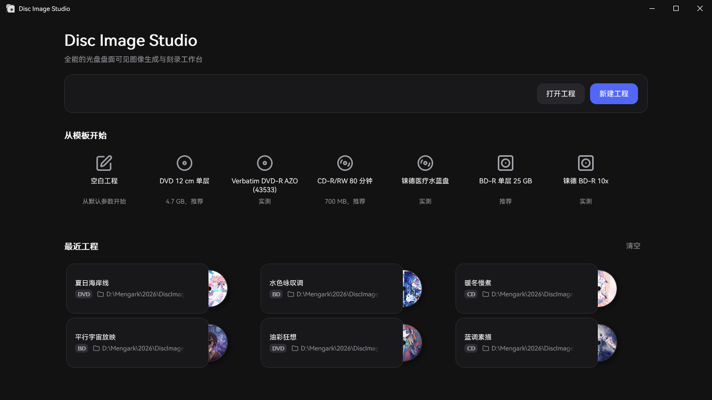
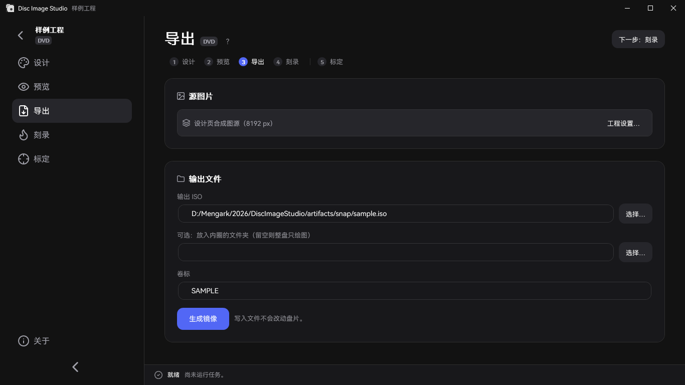
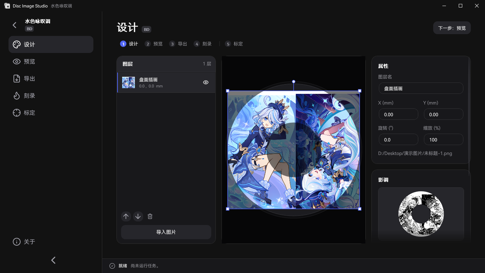
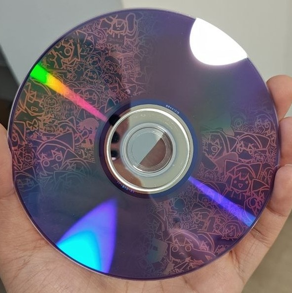
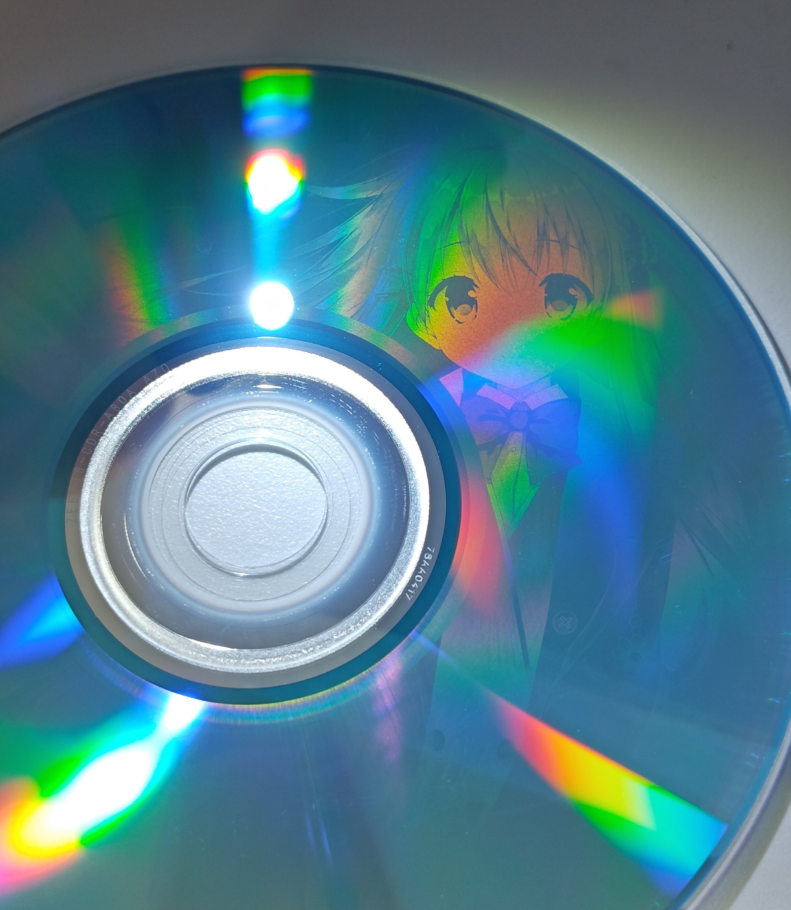
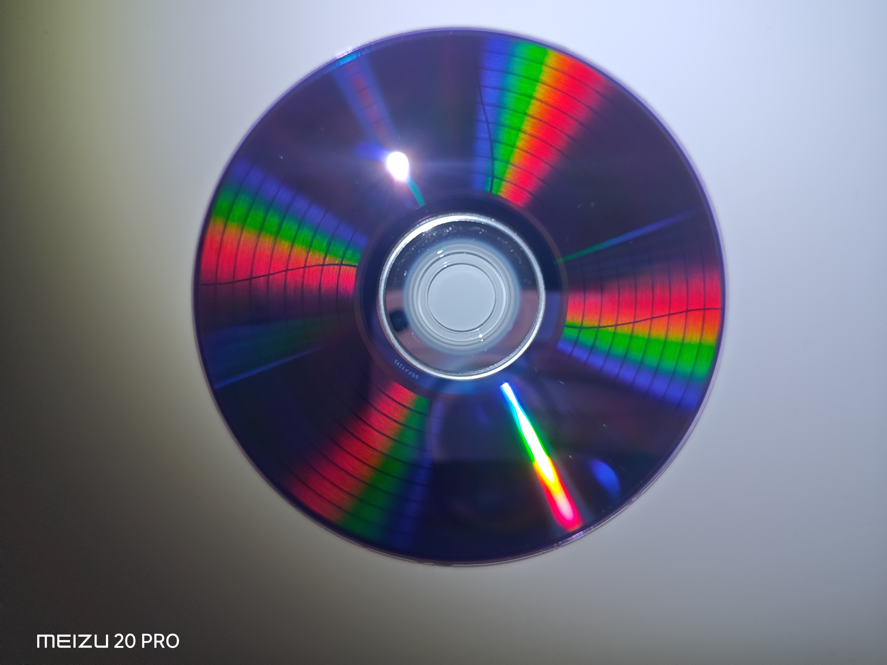
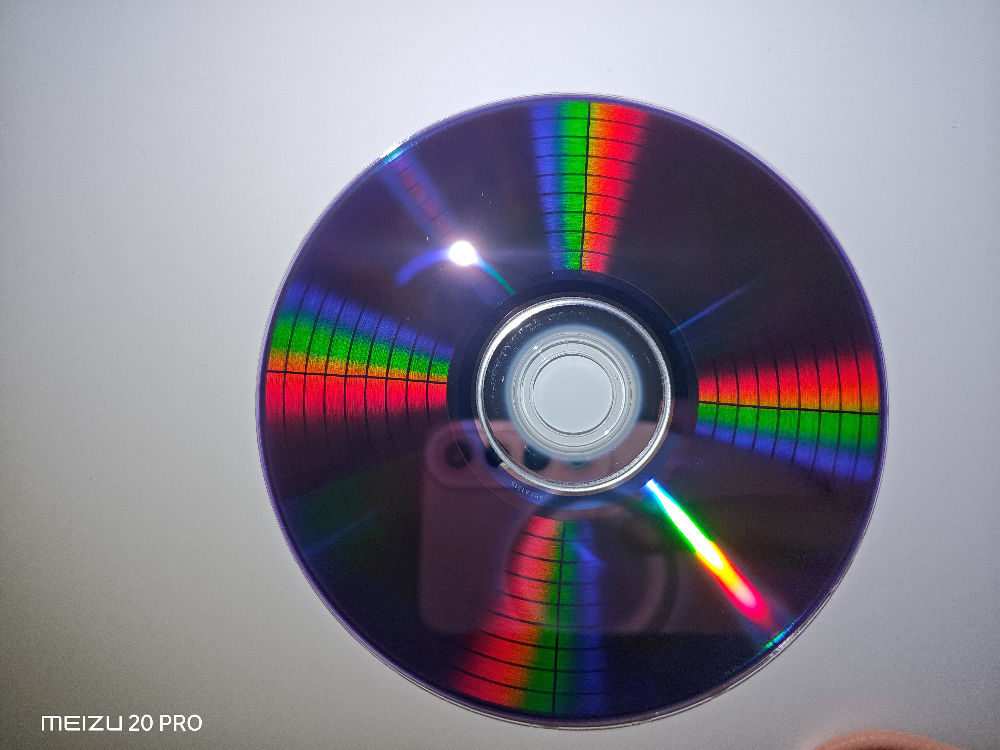

<div align="center">


<h2>全能的光盘盘面可见图像生成与刻录工具</h2>

Disc Image Studio 是一个运行在 Windows 的光盘盘面图像生成与刻录工具，帮助您在符合规格的 DVD / CD 光盘上刻蚀出肉眼可见的图像。


[](LICENSE)

</div>

---

## 界面预览







---

## 效果预览





### DVD 三次轨距校准：实盘前后对比

下面是 Verbatim DVD-R AZO (43533) 的校准图案实拍，拍摄于 2026 年 10 月 4 日。校准前采用恒定轨距，十字线的径向线条出现明显弯曲；使用辅助标定得到的三次轨距参数重新生成并刻录后，线条更接近径向直线。校准后的参数已更新到内置的 **Verbatim DVD-R AZO (43533)（实测）** 预设。

| 校准前 · 恒定轨距 | 校准后 · 三次轨距 |
| --- | --- |
|  |  |
| `P20261004-133519.jpg` · 13:35 | `P20261004-135416.jpg` · 13:54 |

以上保留原始照片，未进行裁切或透视矫正；两次拍摄的角度、光照不同，对比重点是径向线条的形状。

**照片矫正时，请框选盘片实体的最外缘和中心孔边缘，不是绘图区域或刻录区域的内外边缘。** 透明塑料环、刻录区起止线和阴影也不能代替这两条实体边界。程序用盘片规格与中心孔恢复盘心、尺度和透视，再通过绘图曲线标定轨道参数。

<details>
<summary>查看校准前后的完整参数与标定记录</summary>

| 参数 | 校准前 | 校准后 |
| --- | ---: | ---: |
| 内半径（mm） | `23.991455309` | `23.991460627731737` |
| 外半径（mm） | `57.964901267` | `57.964893657925366` |
| 总扇区数 | `2297888` | `2297888` |
| 通道位长（nm） | `133.3` | `133.3` |
| 相对一次项 `pitchLinear` | `0` | `-3.9256854319227684E-05` |
| 相对二次项 `pitchQuadratic` | `0` | `6.964795915429256E-05` |
| 相对三次项 `pitchCubic` | `0` | `-4.670918950137523E-05` |

轨距模型为 `p(x)=p0*(1+c1*x+c2*x²+c3*x³)`，其中 `x=(r-内半径)/(外半径-内半径)`，`c1/c2/c3` 对应上表的三个相对系数。完整三次多项式有四项，轨距尺度 `p0` 由内外半径和总轨道长度自动计算。生成、预览与标定使用同一模型。

原始记录：[校准前参数](docs/examples/dvd-calibration/calibration-81a72aac.calibration.json) · [校准后已验证参数](docs/examples/dvd-calibration/calibration-f2f851f7.calibration.json)。两份记录均保留完整数值精度，可在辅助标定页打开；它们不包含照片描点或拟合过程数据。

操作流程见[辅助标定说明](docs/CALIBRATION.md)，参数定义见 [DVD 引擎说明](docs/DVD_ENGINE.md)。

</details>

---

## 概述

Disc Image Studio 可将一张图片转换成符合 CD、DVD 光盘物理层约束的数据，刻录后将使光盘盘面呈现肉眼可见的图案。新增单层 25 GB BD-R 实验模式，提供参数、源图布局、实时预览及图片数据生成；蓝光默认以 128 为分界，暗部偏 3T、亮部偏 6T 的数量，支持反转，实盘明暗仍需验证。

## 功能

### 光盘数据生成

- **CD-DA 支持**：可导出带格式头的 WAV 音轨及配套 CUE，兼容 cdrecord, ImgBurn等刻录软件；也允许导出 RAW 音轨。详见 [CD 刻录兼容说明](docs/CD_AUDIO_COMPATIBILITY.md)。
- **SIMD 与并行供流**：CD 图片采样使用四点 SIMD，像素边界及不支持的硬件回退原算法；DVD 保留四点 SIMD 和恒定轨距缓存优化。BD 图片与内建标定图案采用有界并行生成，3T/6T 阈值及扰码使用整数 SIMD，输出顺序和生成字节保持一致。
- **DVD 支持**：支持导出 ISO 纯绘图盘与"内圈文件、外圈绘图"的混合数据盘镜像。
- **介质灰度方案**：CD 与 DVD 均使用黑白二阶，输入 `0–127 / 128–255` 对应图片亮度 `0 / 255`。CD 使用 `0D / AA`，DVD 扰码域使用 `A5 / 92`。文件生成、流式刻录和预览同步使用该映射；已抖动黑白图片保持离散像素采样，环形复制在高质量缩放后重新进行二阶抖动。
- **图像处理开关**：CD、DVD 和 BD 制作页及实时预览可开启黑白抖动，默认关闭；独立的“sRGB 伽马校正”开关可在线性亮度下分配黑白像素。处理顺序为图片布局 → 可选伽马校正 → 蛇形 Floyd–Steinberg 黑白抖动，文件生成、流式刻录及源图投影使用相同选项。关闭总开关保留伽马选择，原图文件不会被改写；CD/DVD 环形布局独立于此开关。已有镜像的读回不重复处理。
- **灰度抖动工具**：独立程序也可将原图处理为 `0/255` 黑白二阶 PNG；支持打开或拖入原图、并排预览及无损 PNG 导出。可勾选“sRGB 伽马校正”，默认关闭，命令行通过 `--gamma none|srgb` 选择。详见[使用与构建说明](tools/FourLevelDither/README.md)。
- **DVD 三次轨距模型**：支持轨距随半径变化，生成、预览和辅助标定共用同一套几何；相对系数全为零时使用恒定轨距。上方实盘对比展示了已验证的 Verbatim DVD 校准效果。
- **盘片预设**：内置 JSON + 用户层 JSON 分层配置。详见[预设维护说明](docs/DISC_PRESETS.md)。
- **实时预览**：支持 CD、DVD 和 BD，默认“输入原图”（标定预览）用源图片与生成/实测两套几何做投影；“输入镜像”（读回模拟）读取生成产物（CD 音轨 / DVD ISO / BD ISO）。尺寸按输入值生成，支持 64–8192 px，BD 默认 2048 px；CD/DVD 每扇区采样按输入值生效。画布可用滚轮缩放、拖动查看，支持适应窗口和 1:1 像素查看，导出保留生成分辨率。选择或重新加载盘片预设时，实际参数先同步为预设值，之后可独立微调。BD 预览与蓝光制作页共用源图和生成参数，支持反转 3T/6T 对应关系，并保留内圈文件与尾部元数据占用；ISO 读回用黑白表示本软件的 3T/6T 映射，其他字节显示中性灰，不代表实盘反射亮度。详见 [DVD 引擎说明](docs/DVD_ENGINE.md) 与 [CD 刻录兼容说明](docs/CD_AUDIO_COMPATIBILITY.md)。
- **辅助标定**：使用 `target_slim.png` 细线同心圆与十字线，先按生成外半径缩放原图，再按内外半径裁切刻录区域，与普通 DVD 图片生成映射一致，支持 CD 音轨 / DVD 镜像及流式刻录。界面分为“照片矫正 → 曲线标定”：拖动实体外缘与中心孔轮廓，确认透视矫正后，在一条清楚的曲线上手动打点、拖动修正，反推参数并对照叠加曲线。实拍点优先，不受预设环带裁剪；青色为实拍输入，橙色为参数预测。不要求涂黑、测量或摆正光盘。照片、边界和曲线点一起保存在记录中。当前使用 schema 6，不接受旧版图案记录，详见[辅助标定说明](docs/CALIBRATION.md)。

### 刻录

- **镜像文件输出**：您可以导出完整 ISO / RAW 文件并使用合适的刻录软件手动刻录。
- **即时流式刻录（实验性）**：CD、纯绘图 DVD 与混合 DVD 边生成边刻录，使用 64 MiB 有界内存缓冲（开刻前预填充 32 MiB），不保存完整镜像；刻录页显示根据光驱已写入扇区计算的实时 MB/s 和介质倍率，准备及封盘阶段不显示过时速率。
- **蓝光流式刻录（实验性）**：全新未格式化的单层 BD-R 采用无备用区顺序写入，保持完整 12,219,392 扇区；内圈 UDF 文件、图案与辅助标定共用相同几何和数据流，不自动缩容。BD 写入按 32 扇区分块，单命令超时 200 秒，失败不自动重写；实时速率按光驱确认接收的数据计算，包含设备缓存影响。详见[蓝光说明](docs/ADDING_BLURAY.md#无备用区流式刻录)。
- **拒绝非空白介质！**

### 应用形态

- [DVD 灰阶实验工具](tools/DvdGrayProbe/README.md)：制作 `64/E4` 的纯色与抖动混合对比测试镜像，使用显式码字和 43533 校准参数。
- 双入口：不带参数将打开 GUI；带参数则进入统一命令行。
- 主页支持 CD、DVD、BD 类型选择、新建和打开源图片，也可以按盘片预设快速创建，并回访这三种类型最近生成的任务。
- 模块化：CD、DVD 与单层 BD-R 通过 `IOpticalDiscModule` 接入；蓝光编码和实验命令独立于 CD/DVD，使用范围见[蓝光说明](docs/ADDING_BLURAY.md)。

## 系统与设备要求

- Windows 10 2004（2004/20H1，19041）及以上，或 Windows 11。
- 构建：.NET 9 SDK（`global.json` 锁定 9.0.x）；自行构建的非自包含 GUI 需要 .NET 9 Windows 桌面运行时。Release EXE 已包含运行时，无需另行安装 .NET。
- “即时刻录”功能需要一台 Windows 可识别的 CD / DVD 刻录机与空白盘片。

## 下载与发布

已公开的正式版与预发布版见 [GitHub Releases](https://github.com/JiaFeiMiao-K-Cat/DiscImageStudio/releases)。

版本规则、GitHub Actions 自动生成 EXE、Release 草稿检查与 MSIX 打包方式见[发布指南](docs/RELEASING.md)。

## 构建与运行

```powershell
dotnet build DiscImageStudio.slnx --configuration Release
dotnet run --project src/DiscImageStudio.App --configuration Release
```

构建回归检查：

```powershell
dotnet run --project src/DvdImageSolver --configuration Release -- selftest
dotnet run --project tests/DiscImageStudio.ArchitectureTests --configuration Release
```

MSIX 打包、测试包签名与发布流程见[发布指南](docs/RELEASING.md)。

## 命令行

统一程序不带参数时将打开 GUI，而带参数时作为自动化工具使用：

| 命令 | 说明 |
| --- | --- |
| `solve` | 使用固定快速纹理映射（CW 方向）生成 DVD 镜像 |
| `encode` | 将单个 DVD ECC 块编码为 NRZI 通道电平 |
| `calibrate` | 标定投影：按生成几何从 DVD 源图片取样，按实测几何投到盘面 |
| `simulate` | 按实测半径对生成的 DVD ISO 做读回模拟 |
| `selftest` | 运行 DVD 引擎的确定性回归自检 |
| `cd-generate` | 将图片映射为 WAV + CUE 或旧 RAW CD-DA 音轨，可选延迟交织 |
| `cd-preview-warp` | 标定投影：按生成几何从 CD 源图片取样，按实测几何投到盘面（`--actual-r0` / `--actual-r1`） |
| `cd-preview-track` | 按标定几何渲染已有的 WAV 或 RAW CD-DA 音轨（读回模拟，默认逆交织） |
| `bd-info` | 查看或导出单层 25 GB BD-R 名义参数 |
| `bd-probe` | 导出显式指定扰码后字节的原始用户扇区实验样本 |
| `bd-encode` | 将一个 64 KiB 用户数据块编码为 ECC 诊断数据 |
| `bd-generate` | 按 3T / 6T 数量偏向生成 UDF ISO，支持大于 4 GiB 的内圈单文件、`--total-sectors`、`--data-dir` 与 `--invert true` |

完整 DVD 引擎说明见 [DVD_ENGINE.md](docs/DVD_ENGINE.md)。

## 源码结构

```text
src/DiscImageStudio.Core/    介质无关的模块契约、元数据、任务与命令目录
src/DiscImageStudio.Imaging/ 可复用的图片预处理层
src/DiscImageStudio.Burning/ Windows IMAPI2 设备枚举、流缓冲与安全刻录层
src/DiscImageStudio.Cd/      CD-DA 生成核心与 CD 模块
src/DiscImageStudio.Dvd/     DVD 引擎适配模块
src/DiscImageStudio.BluRay/  单层 BD-R 编码、几何及实验数据生成
src/DiscImageStudio.App/     WPF GUI、统一命令行与商店资源
src/DvdImageSolver/          保持隔离的 DVD 编码/求解引擎
tests/                       无第三方测试框架的架构回归测试
packaging/                   MSIX 清单与打包脚本
tools/                       资产生成与 EFM 表生成的辅助脚本
docs/                        架构、引擎、预设、发布等文档
```

## 文档

| 文档 | 内容 |
| --- | --- |
| [架构说明](docs/ARCHITECTURE.md) | 模块抽象、层间边界与扩展规则 |
| [DVD_ENGINE.md](docs/DVD_ENGINE.md) | DVD NRZI 图像约束求解器的约定、编码链与自检覆盖 |
| [DISC_PRESETS.md](docs/DISC_PRESETS.md) | 可编辑盘片预设的分层 JSON 格式与合并规则 |
| [CALIBRATION.md](docs/CALIBRATION.md) | 照片矫正、曲线标定与 DVD 三次轨距拟合 |
| [ADDING_BLURAY.md](docs/ADDING_BLURAY.md) | 单层 BD-R 参数、编码、实验命令及待定的黑白映射 |
| [VALIDATION.md](docs/VALIDATION.md) | 各轮构建、回归与实盘测试的本地验证记录 |
| [RELEASING.md](docs/RELEASING.md) | GitHub Release、MSIX 打包、签名测试与商店提交流程 |
| [CHANGELOG.md](CHANGELOG.md) | 版本变更记录 |

## 参考标准

实现与物理模型主要参考以下介质规范。标准名义参数用于建立初始模型，实际绘图仍需盘片与刻录设备的实测校准。

| 介质 | 标准与版本 | 本项目采用的范围 |
| --- | --- | --- |
| CD-R | [ECMA-394，第 1 版，2010 年 12 月](https://ecma-international.org/publications-and-standards/standards/ecma-394/) — *Recordable Compact Disc Systems CD-R Multi-Speed*（[官方 PDF](https://ecma-international.org/wp-content/uploads/ECMA-394_1st_edition_december_2010.pdf)） | CD-R 介质、多速录制及 CD-DA 兼容关系；本项目生成 CD-DA 音轨。 |
| DVD 公共格式 / DVD-ROM | [ECMA-267，第 3 版，2001 年 4 月](https://ecma-international.org/publications-and-standards/standards/ecma-267/) — *120 mm DVD – Read-only disk*（[官方 PDF](https://ecma-international.org/wp-content/uploads/ECMA-267_3rd_edition_april_2001.pdf)） | DVD 数据帧、ECC、EFMPlus 编码及附录 G 转换表；可记录盘的介质规则另参考 ECMA-359。 |
| DVD-R | [ECMA-359，第 1 版，2004 年 12 月](https://ecma-international.org/publications-and-standards/standards/ecma-359/) — *80 mm (1,46 Gbytes per side) and 120 mm (4,70 Gbytes per side) DVD Recordable Disk (DVD-R)*（[官方 PDF](https://ecma-international.org/wp-content/uploads/ECMA-359_1st_edition_december_2004.pdf)） | 单层 DVD-R 的几何、扇区、纠错和编码；标准包含单面及双面介质，双面不等于双层。 |
| BD-R | [ISO/IEC 30190:2021，第 3 版，2021 年 1 月](https://www.iso.org/standard/80770.html) — 120 mm 单层（25.0 GB）及双层（50.0 GB）可记录 BD 的信息交换与存储规范 | 实验模式采用单层 25 GB 的轨道、扇区布局、纠错和编码；目前不支持双层盘。 |

CD 公共编码部分还参考 [ECMA-130，第 2 版（CD-ROM，1996）](https://ecma-international.org/publications-and-standards/standards/ecma-130/)，不将其等同于 CD-DA 的全部规范。具体物理模型复核见 [PHYSICAL_MODEL_AUDIT.md](docs/PHYSICAL_MODEL_AUDIT.md)，蓝光实现范围见 [ADDING_BLURAY.md](docs/ADDING_BLURAY.md)。这些引用表示实现依据，不代表完成了整套标准的符合性认证。

## 刻录与介质安全须知

- Disc Image Studio 不安装驱动或服务；“即时刻录”功能使用了 Windows 自带的 IMAPI2，拒绝非空白介质。
- “即时刻录”功能已有部分实盘反馈，对不同设备、介质与刻录入口的验证覆盖仍有限，属于实验性功能，请只使用可报废的测试介质。刻录中断、断电或生成速度不足仍可能使盘片报废！
- 实际可见效果取决于盘片、刻录机、固件与写入策略。
- DVD 混合文件夹会在开始刻录前扫描目录并固定布局；期间源文件大小改变会安全终止任务，但已开始写入的盘片仍可能报废。

## 隐私与安全

- Disc Image Studio 不联网、不上传文件、不收集遥测，详见[隐私政策](PRIVACY.md)。
- 发现安全问题请不要在公开 Issue 中披露，按[安全政策](SECURITY.md)使用 GitHub 私密报告。

## 贡献

欢迎报告问题与提交代码。开发环境搭建、模块边界规则、测试要求与 Pull Request 流程见[贡献指南](CONTRIBUTING.md)。

## 许可证

项目采用 [GNU GPL v3.0 or later](LICENSE)（`GPL-3.0-or-later`）。CD 交织实现包含从 CDImage 移植并修改的代码，整体分发沿用兼容的 GPL 授权；分发二进制或修改版时须遵守对应源代码等要求。第三方字体与组件遵循各自许可证，详见 [授权说明](LICENSE-NOTICE.md) 和 [第三方声明](THIRD-PARTY-NOTICES.txt)；应用“关于”页也可离线查看完整文本。

## 致谢

感谢 [arduinocelentano 的 CDImage 项目](https://github.com/arduinocelentano/cdimage)，它展示了通过生成 CD 音轨在盘面形成可见图像的方法。本项目的 CD 交织实现由其相关代码移植并继续修改，CD 盘面绘图思路也受其启发。CDImage 原作者及贡献者的工作为本项目提供了重要基础；上游采用 GPL-3.0-or-later，相关版权与许可声明已保留。

---

## Star History

<a href="https://www.star-history.com/?repos=jiafeimiao-k-cat%2Fdiscimagestudio&type=date&legend=top-left">
 <picture>
   <source media="(prefers-color-scheme: dark)" srcset="https://api.star-history.com/chart?repos=jiafeimiao-k-cat/discimagestudio&type=date&theme=dark&legend=top-left" />
   <source media="(prefers-color-scheme: light)" srcset="https://api.star-history.com/chart?repos=jiafeimiao-k-cat/discimagestudio&type=date&legend=top-left" />
   
 </picture>
</a>
