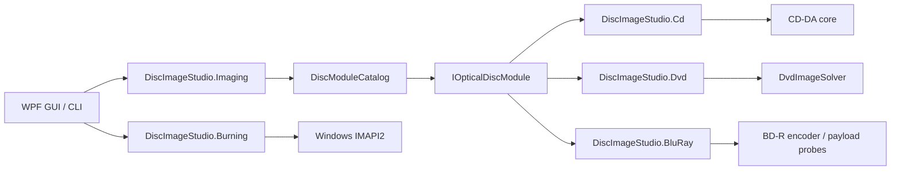

# 架构说明

## 目标

核心目标是让应用外壳不依赖某一种光盘编码。CD、DVD、蓝光的物理调制、纠错、扇区组织和文件系统不同，因此共享的是任务生命周期和产品能力，不共享错误的“万能编码器”基类。

## Core 契约

`DiscImageStudio.Core` 不引用 WPF、CD、DVD 或任何具体编码器，并以 `net9.0` 为目标。

- `IOpticalDiscModule`：模块执行边界。
- `DiscModuleDescriptor`：模块 ID、介质家族、取消能力和命令元数据。
- `DiscCommandDescriptor`：命令、能力和选项定义，可供未来动态生成界面。
- `DiscJobRequest`：统一命令与参数载体。
- `DiscJobProgress`：介质无关的进度、阶段、完成量和耗时。
- `DiscJobResult`：退出码、摘要和输出路径。
- `DiscModuleCatalog`：命令路由、重复命令检查和模块执行。
- `BinaryGrayscale`：当前 CD/DVD 共用的黑白图片分档，阈值128、亮度 `0/255`；byte 码表仍由各自编码模块拥有。
- `FourLevelGrayscale`、`ThreeLevelGrayscale`：保留的多阶实验分档定义，不用于当前 CD/DVD 生成和独立工具默认处理。

`OpticalDiscFamily.BluRay` 由独立的 `BluRayDiscModule` 实现，当前范围为单层 25 GB BD-R；图片生成采用可反转的 3T / 6T 数量偏向映射，参数、编码诊断和显式字节实验也可用。

盘片预设由各介质模块自行定义：CD/DVD 使用现有 JSON 目录；`DiscImageStudio.BluRay` 持有独立的单层名义 BD-R 预设，未修改 CD/DVD 参数模型。

## 图片预处理层

`DiscImageStudio.Imaging` 位于界面与介质编码模块之间。当前提供环形复制布局：根据源图宽高比和可用圆周自动计算份数，将同一张图复制多份并使顶部朝向光盘外侧；每份图像使用同一缩放比例，并同时受内圈、外圈和相邻扇区边界约束，放不下时自动等比缩小，从几何上避免变形、裁切与重叠。它输出普通方形 PNG，因此 CD、DVD 以及未来蓝光模块都能复用，而不需要互相引用介质专用实现。

`GrayscaleDither` 提供独立于光盘编码的蛇形 Floyd–Steinberg 误差扩散：按选定灰度的实际间隔选择最近值并传播误差，输出 Gray8 PNG，透明像素合成到白底，保留像素尺寸和 DPI。`FourLevelDither` 保留实验工具使用的四阶调用入口。独立窗口与命令行位于 `tools/FourLevelDither`，引用 Imaging 与 Core，DVD/CD 两种介质模式均输出黑白 `0/255`，仅展示的物理 byte 对应关系不同。

主程序 CD/DVD/BD 提供默认关闭的图像处理总开关和独立 sRGB 伽马开关。`RingImagePreparation.PrepareImage` 统一生成、流式刻录及源图投影的临时图片生命周期：关闭处理且无环形布局时透传原图；开启时先布局，再对连续亮度执行一次可选伽马校正与二阶抖动。CD/DVD 环形布局在关闭总开关时仍保留对已抖动黑白输入的自动重抖动；开启时禁用这一步，避免提前丢弃灰度。开启处理的环形源图投影采用与生成一致的 8192 像素中间图，最终显示分辨率仍可调。BD 没有环形复制，实际生成和源图投影保留原图尺寸；其页面布局缩略图在既有尺寸上限内独立处理。已有轨道/ISO 的读回不应用新处理。临时图片在完成、取消或失败后清理，不修改用户原图。

`Process` 和 `ProcessPixels` 的可选参数 `linearizeSrgb` 默认false，原有调用保持编码RGB空间中的结果。设为true时，使用标准分段sRGB逆传递函数逐通道解码，再计算线性亮度、合成白底；调色板也解码到同一线性空间进行最近值量化和误差扩散，输出仍写回原调色板byte。主程序与独立工具的开关、独立工具CLI参数显式控制此选项；当前将解码后的RGB输入值按sRGB解释，不增加ICC色彩管理或盘片反射率补偿。

## 流式刻录层

CD 的 `OpticalBurnRequest.ProduceContent` 明确要求无头的 44.1 kHz、16 位、双声道小端 PCM，`ContentLength` 只计音频数据。CD 生成器的默认无头流保留旧大端输出，调用 IMAPI 时由外壳显式选择 `CdAudioByteOrder.LittleEndian`；转换在延迟交织完成后的整扇区输出处进行。文件生成根据 `.wav` / `.raw` 后缀选择格式：WAV 使用同样的小端音频数据，额外写入 44 字节 RIFF 头和同名 WAVE CUE；旧 RAW 保持大端。Windows RAW 镜像构造器实测原样保留传入字节，不负责修正字节序。详见 [CD 刻录兼容说明](CD_AUDIO_COMPATIBILITY.md)。

`DiscImageStudio.Burning` 只负责 Windows IMAPI2 设备枚举、介质检查、COM `IStream` 适配、64 MiB 有界内存缓冲（开刻前预填充 32 MiB）和刻录生命周期。自动速度会在真正开始 CD/DVD 刻录时重新读取当前盘片的写入配置并选择最低值，手动选择仍保持原值；设备不报告速度时使用刻录接口的保守回退。CD/DVD 生成器仍拥有介质格式：CD 顺序产生 2352 字节音频扇区，DVD 快速算法顺序产生 2048 字节数据扇区。刻录器按需读取这些块，因此磁盘上不出现完整镜像。原文件输出入口不经过该层，失败时不会破坏原工作流。

蓝光使用独立的 `IBluRaySequentialSession` 和可模拟 MMC 命令层：对未格式化单层 BD-R 读取原始容量，以 `IWriteEngine2` 直接顺序写入、刷新、关闭轨道并封盘，不进入 `IDiscFormat2Data.Write` 的自动格式化流程。设备独占、介质移除锁和 MCN 的释放与错误处理集中在会话实现；失败时保留原始错误，不回退到其他刻录方案。`OpticalBurnRequest.ContentLength` 与几何计划均保留用户设定的完整扇区数，默认 12,219,392；无备用区模式不支持 BD-RE 或随机记录盘。

DVD 和蓝光的内圈文件采用两阶段顺序生成：第一阶段扫描目录、规划文件 extent 和绘图区；第二阶段在严格前向、不可 Seek 的流中依次写入文件系统、文件和图案。`DiscImageStudio.Iso` 分别提供 DVD 的 ISO9660/Joliet 与蓝光的 UDF 2.01；DVD 与 BD 模块拥有各自的对齐规则、几何和 payload。UDF 分区仅覆盖内圈文件，绘图区位于分区之后、盘尾备份描述符及锚点之前。布局计划只保存元数据，文件以有界缓冲区顺序读取；64 位文件长度与分段 allocation descriptor 支持大于 4 GiB 的文件。文件和流式刻录共用生产路径。

## 模块边界

### CD

`DiscImageStudio.Cd` 拥有 CD 几何、图片采样、RAW 输出和延迟交织。它实现取消，并把字节进度转换成统一的 `DiscJobProgress`。

### DVD

`DiscImageStudio.Dvd` 是薄适配器。它只负责元数据、路由与结果归一化，然后调用隔离的 `DvdImageSolver`。DVD 引擎原参数和自检保持不变。

### Blu-ray

`DiscImageStudio.BluRay` 引用 Core 和 Iso，拥有单层 BD-R 几何、EDC、扰码、LDC/BIS 及 17PP 代码。`IBluRayPayloadMapping` 接收名义扇区/PSN并填充扰码域用户字节；`BluRayRunLengthMapping` 使用共享二阶阈值 128，在该模块内选择 `AA`（偏 3T）/ `44`（偏 6T），支持反转。图片解码通过委托注入模块，保持 WPF 依赖在 App。顺序生成器做反扰码并输出绘图用户扇区；`BluRayIsoGenerator` 在此前加入 UDF 文件系统/文件字节，之后写入盘尾备份元数据。文件入口采用临时文件完成后发布，取消和失败不会留下被当作成品的半截文件。

`bd-info` / `bd-probe` / `bd-encode` 分别导出参数、显式字节的 payload 样本和 ECC 诊断数据。`bd-generate` 与 GUI 均输出完整 UDF ISO，可手动调整总扇区数并包含内圈文件夹；局部原始范围只由 `bd-probe` 提供。蓝光页面索引为 8，既有页面索引保持稳定。刻录页支持第三介质 `BluRayData`，实际盘型、速度、确认和取消统一校验。辅助标定保存 BD 容量/半径/极性/绘图起止位置，以独立弧长模型拟合和回填，排除两端文件系统元数据；Core 中的标定数学不引用蓝光编码器。当前尚未提供蓝光读回模拟；详见 [蓝光说明](ADDING_BLURAY.md)。

## 扩展规则

1. 模块 ID 和命令名必须全局唯一，目录会在启动时拒绝冲突。
2. 模块不得从 GUI 控件读取状态；输入全部来自 `DiscJobRequest`。
3. 模块不得直接显示窗口；日志、进度和结果通过契约返回。
4. 如果底层算法不能安全取消，`SupportsCancellation` 必须为 `false`。
5. 介质专用格式留在专用模块；只有稳定且真正共享的概念进入 Core。
6. 新模块必须增加目录路由测试和一个最小输出冒烟测试。
